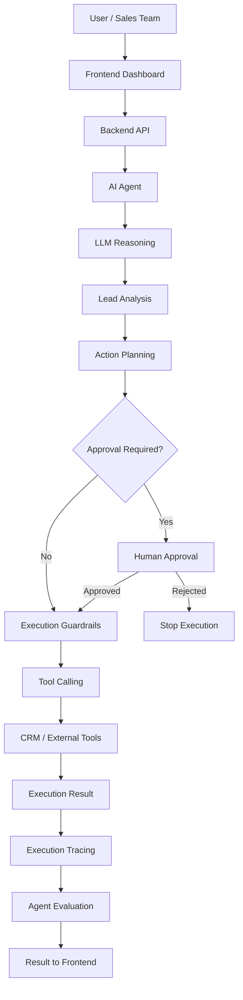

# PipelinePilot AI
### An Agentic AI CRM Assistant for Intelligent Lead Analysis and Workflow Automation

PipelinePilot AI is an AI-powered CRM automation agent that analyzes lead information, understands prospect context, recommends actionable next steps, and executes business operations through tools with appropriate approval guardrails.

Unlike traditional LLM chatbots that only generate responses, PipelinePilot AI focuses on **action-oriented AI workflows**, combining intelligent decision-making, tool execution, human-in-the-loop approvals, and agent evaluation to improve automation reliability and transparency.

---

## Project Overview

Sales teams often spend significant time analyzing leads, understanding prospect requirements, updating CRM records, and deciding what actions to take next.

PipelinePilot AI aims to simplify these workflows through an intelligent AI agent that can:

- Analyze CRM lead information and prospect context.
- Generate contextual insights and actionable recommendations.
- Interact with external tools to perform business operations.
- Apply approval guardrails before executing sensitive actions.
- Maintain execution traces for debugging and transparency.
- Evaluate agent performance and identify opportunities for improvement.

**Core Objective:** Build an AI agent that doesn't just understand business requirements but can also take controlled, measurable actions.

---

## Key Features

### 1. Intelligent Lead Analysis
- Analyzes CRM lead information and available prospect details.
- Understands prospect context using LLM-powered reasoning.
- Generates contextual insights and recommended next steps.
- Supports intelligent decision-making for CRM workflows.

### 2. Agentic AI & Tool Calling
- Implements LLM-driven agent workflows.
- Uses tool calling to connect AI reasoning with external business operations.
- Enables controlled execution of predefined CRM actions.
- Separates AI-generated decisions from actual tool execution.

### 3. Human-in-the-Loop (HITL) & Approval Guardrails
- Introduces approval mechanisms for controlled AI execution.
- Applies guardrails before sensitive business operations.
- Keeps human oversight within automated workflows.
- Helps prevent unintended or unauthorized actions.

### 4. Agent Evaluation & Execution Tracing
- Implements agent evaluation capabilities to assess workflow performance.
- Tracks agent execution and tool interactions.
- Provides visibility into agent decisions and execution steps.
- Helps identify failures and improve reliability.

### 5. Backend & Frontend Integration
- Maintains a modular backend and frontend architecture.
- Connects AI-driven workflows with the application interface.
- Supports interaction between users, AI agents, and business tools.

---

## System Architecture

PipelinePilot AI follows an agent-oriented architecture that connects user interactions, LLM reasoning, tool execution, and approval workflows.



### Agent Workflow

1. **Input Processing:** Receive lead information and relevant prospect context.
2. **Context Understanding:** Analyze available information using an LLM.
3. **Decision Making:** Determine appropriate recommendations and potential actions.
4. **Tool Selection:** Identify the tools required to execute the selected actions.
5. **Approval & Guardrails:** Apply approval checks where required.
6. **Action Execution:** Execute approved operations through available tools.
7. **Evaluation & Tracing:** Record execution details and evaluate agent behavior.

---

## Technology & Engineering Concepts

| Category | Technologies / Concepts |
|---|---|
| Programming | Python |
| Backend | FastAPI, REST APIs |
| AI & Generative AI | LLMs, GPT, OpenAI API |
| Agent Development | Agentic AI, AI Agents, Tool Calling, Function Calling |
| AI Workflow | Agent Orchestration, Workflow Automation |
| Reliability | Human-in-the-Loop, Approval Guardrails |
| Evaluation | Agent Evaluation, Execution Tracing |
| Frontend | React |
| Development | Git, Docker |

*The table identifies the technologies and engineering concepts relevant to the project. Confirm each framework and integration against the actual implementation before treating it as a complete dependency list.*

---

## Project Structure

```text
PipelinePilot-AI/
│
├── backend/
│   └── Backend application and AI agent implementation
│
├── frontend/
│   └── Frontend application and user interface
│
├── docker-compose.yml
│
└── README.md
```

---

## Getting Started

### Prerequisites

- Git
- Docker Desktop
- Docker Compose

For development outside Docker, install the dependencies specified by the backend and frontend projects.

### 1. Clone the Repository

```bash
git clone https://github.com/vivekThoke/PipelinePilot-AI.git
```

### 2. Navigate to the Project

```bash
cd PipelinePilot-AI
```

### 3. Run Using Docker Compose

```bash
docker compose up --build
```

Docker Compose builds and starts the services defined in `docker-compose.yml`.

### 4. Stop the Application

```bash
docker compose down
```

**Note:** Configure any required environment variables and API credentials according to the backend and frontend configuration before starting the application.

---

## Reliability & Responsible AI

PipelinePilot AI emphasizes controlled AI execution rather than unrestricted autonomous actions.

Key engineering principles include:

- **Controlled Execution:** AI-generated actions pass through defined execution controls.
- **Human Oversight:** Approval mechanisms provide human supervision for sensitive operations.
- **Transparency:** Execution tracing provides visibility into agent behavior.
- **Evaluation:** Agent workflows can be assessed to identify reliability issues.
- **Separation of Concerns:** AI reasoning, approval decisions, and tool execution are treated as distinct workflow stages.

---

## Future Enhancements

Potential areas for further development include:

- Advanced multi-agent orchestration.
- Expanded CRM platform integrations.
- Persistent conversation and execution memory.
- Advanced agent evaluation and benchmarking.
- Retry mechanisms and failure recovery.
- Detailed agent observability and performance analytics.
- Role-based access control and audit logging.
- Production deployment and scalability improvements.

---

## What This Project Demonstrates

PipelinePilot AI demonstrates practical engineering concepts in:

- Agentic AI and LLM-powered application development.
- Intelligent decision-making and workflow orchestration.
- LLM function calling and external tool integration.
- Human-in-the-loop AI systems.
- AI agent evaluation and execution observability.
- Building AI-powered applications with backend and frontend integration.

---

## Author

**Vivek Thoke**

- GitHub: [@vivekThoke](https://github.com/vivekThoke)
- LinkedIn: [vivekthoke](https://www.linkedin.com/in/vivekthoke/)

---

⭐ If you find this project interesting, consider giving the repository a star!

**Built to move beyond AI-generated answers towards intelligent, controlled AI-driven actions.**
